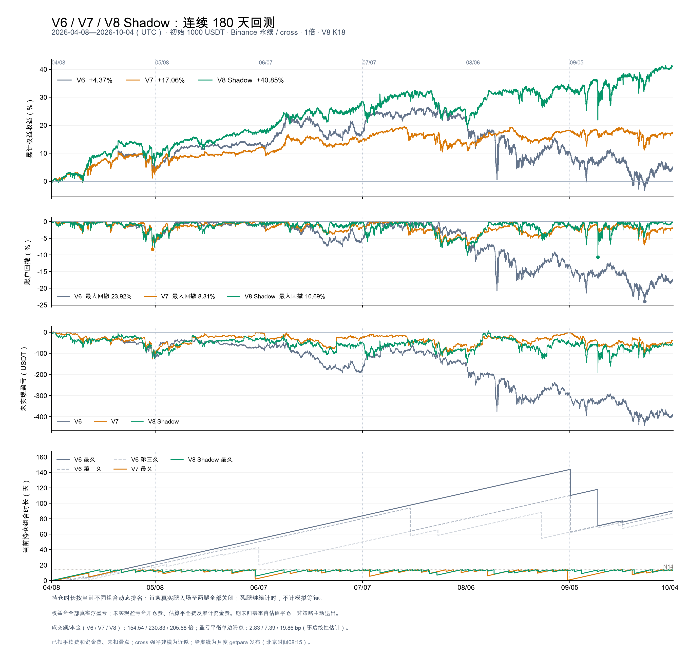

# V6 / V7 / V8 Shadow 连续180天回测

区间：2026-04-08 00:00—2026-10-04 23:55 UTC，共180个日历日。初始1000 USDT，Binance USDT永续cross，1倍，单边手续费0.05%，零滑点。4/8空仓、无3月继承关系。

| 版本 | 收益 | 5m含浮盈亏回撤 | 成交腿数 | 成交额/初始资金 | 盈亏平衡单边滑点 | 最长实际持仓 |
| --- | ---: | ---: | ---: | ---: | ---: | ---: |
| V6 | 4.37% | 23.92% | 2282 | 154.54倍 | 2.83bp | 144.09天 |
| V7 | 17.06% | 8.31% | 3364 | 230.83倍 | 7.39bp | 14.00天 |
| V8 Shadow | 40.85% | 10.69% | 3013 | 205.68倍 | 19.86bp | 14.00天 |

收益已扣手续费、资金费，未扣滑点。成交额为进出场累计名义金额；盈亏平衡滑点为turnover_compensation.py对已成交路径的事后线性估计，不是重新模拟滑点。

本窗口V8 Shadow收益高于V7，但最大回撤也更高；不能把更高收益解释成风险同步下降。V6后半段累计收益明显回落，并出现长期未退出敞口。三版本整体机制不同，本次不能单独归因于某一个参数或功能。

## 设置与可比性

- V6保留原逻辑，没有N超时；V7为N14，按原候选数预算；V8只运行Shadow版，N14/K18、固定槽位预算。三者引擎最多36条腿。
- V6/V7每批最多18对；V8每批最多40对。6次发布时间为4/8、5/8、6/7、7/7、8/6、9/5，均延迟15分钟至UTC00:15（北京时间08:15），每次使用此前90天的冻结拟合。公告检测延迟5分钟。
- 与上一轮四版本比较使用同一策略决策源码；V8是10/13实盘执行修复前的原离线版本，源码逐字节冻结，未覆盖当前实盘代码。未重新拟合、调参或改变手动getpara部署规则。
- 本次研究使用独立PeriodBoundary输入适配：修正旧结算注入保护把期末后一天也当作区间内的误报。PROMPT在10/5 09:00结算，超出本次10/4范围；缺失的期外结算价不再阻止回测，区间内缺价仍然拒绝，已验证结算注入保持。原策略文件和已验收结算表均未修改，首轮拦截记录保留，真实冻结方法的边界验收见period_boundary_acceptance.json。
- 前报告4/8—7/7窗口的正常已平腿15项交易字段（含价格、数量、方向、费用、资金费、净盈亏）一致，原生权益观测序列也完全一致；前报告期末force_exit估值在本次连续运行中不实际执行。
- 7/7—10/4此前已在V7半年研究中观察。本次用户明确授权三版本固定参数扩展；不能再称作独立、未观察样本外终测。

## 前后90天

| 版本 | 前90天收益 | 后90天区间收益 | 后90天区间最大回撤 |
| --- | ---: | ---: | ---: |
| V6 | 17.35% | -11.06% | 23.92% |
| V7 | 14.94% | 1.84% | 7.64% |
| V8 Shadow | 28.40% | 9.69% | 10.69% |

区间收益按连续资金曲线计算，后段没有重置资金或持仓；分段回撤在区间起点重置峰值。

## 未实现盈亏与持仓年龄

主图四个子图分别为累计账户收益、含浮盈亏回撤、未实现盈亏、当前最长持仓年龄。全部为5分钟原生循环口径；未实现盈亏=原生账户权益−初始资金−观察时点前已平仓净盈亏，因此包括所有真实腿的费用和已累计资金费，虚拟仓不计入。组合数量逐时与原生持仓日志核对。

持仓年龄从本轮第一条真实腿入场计至组合完全平仓，存在残腿时继续；完全平仓后再次入场重新计时。按每个时点不同组合动态排序，V6最长实线、第二久不透明度55%虚线、第三久不透明度30%虚线；不是固定选择三对币。V7/V8显示各自最长实际持仓，V8不以模拟N起点替代真实成交起点。

| 版本 | 最长持仓组合 | 观察到的最大天数 | 最低未实现盈亏 |
| --- | --- | ---: | ---: |
| V6 | USTC–VTHO | 144.09 | -442.21 USDT |
| V7 | USTC–VTHO | 14.00 | -125.46 USDT |
| V8 Shadow | ALL–MEW | 14.00 | -193.45 USDT |

V6期末估值前在仓年龄前三：CRV–GOAT 90.34天；ME–WAL 87.22天；1000XEC–SONIC 82.23天。

期末未实现盈亏归零来自回测估值平仓，不代表策略已主动结束所有持仓。持仓最大时长是截至本窗口末尾已观察到的时长，不是对未平仓组合最终寿命的预测。

## 验收与限制

| 版本 | 完整配对入场 | 已恢复单腿入场 | 未通过现代配对恢复标准的入场 | 期末估值腿数 | 期末估值盈亏 |
| --- | ---: | ---: | ---: | ---: | ---: |
| V6 | 988 | 0 | 306 | 35 | -396.77 USDT |
| V7 | 1682 | 0 | 0 | 10 | -40.96 USDT |
| V8 Shadow | 1505 | 3 | 0 | 28 | -57.56 USDT |

V6保留历史逻辑及其单腿敞口，不能视作现代成对恢复验收通过。V7/V8必须无未恢复入场；已恢复记录全部保留在收益内。各腿资金费与固定镜像原生公式误差<1e-8 USDT；逐腿账本、独立标记权益、退市结算审计通过。

原生cross共享保证金/强平模拟仍是近似。退市结算价使用官方月度markPriceKlines结算K线开盘价代理，并校验官方CHECKSUM；并非币安公布的实际永续结算价。5分钟采样无法捕捉更细的瞬间回撤；1小时标记价格重建另存，不能与主图回撤混用。
